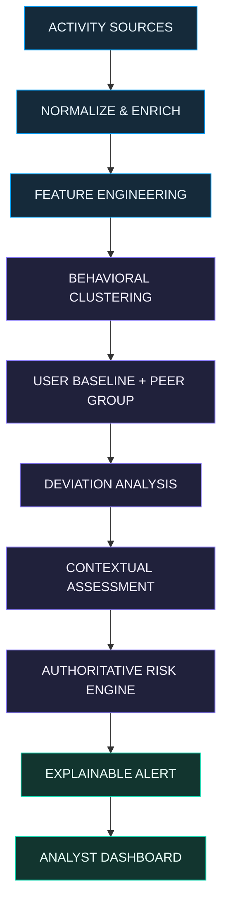
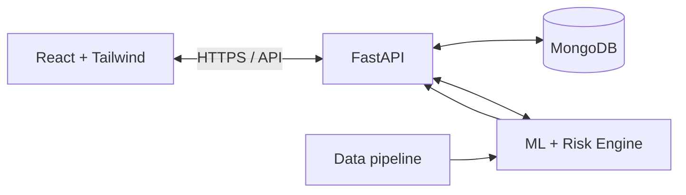

from pathlib import Path
import pypandoc

readme = r'''<div align="center">

# ◉ ARGUS
### SEE BEYOND THE OBVIOUS

**Context-aware insider-threat detection · Behavioral intelligence · Explainable risk**

<p>
  
  
  
</p>

<p><em>An unusual action is a signal. Context tells us what it means.</em></p>

</div>

---

<div align="center">

```text
       ▄████████████████████████████████▄
     ▄██   A R G U S   /   WATCHTOWER     ██▄
    ██                                      ██
   ██       .------------------------.       ██
   ██       |   BEHAVIOR  +  CONTEXT  |       ██
   ██       '-----------+------------'       ██
    ██                  |                   ██
     ▀██▄       EXPLAINABLE RISK        ▄██▀
        ▀████████████████████████████▀
```

**ARGUS** is a context-aware insider-threat detection prototype. It studies activity patterns, compares users with their own history and relevant peer groups, then considers organizational and technical context before producing an explainable risk assessment.

[Repository](https://github.com/ayush2048kr/ARGUS) · [Issues](https://github.com/ayush2048kr/ARGUS/issues) · [Project documentation](docs/)

</div>

## 01 — The signal is not the story

A user downloads an unusually large number of files at 9:30 PM.

Is that an insider threat?

Not necessarily. The user may be an administrator completing an approved migration, an analyst working an incident, or an employee behaving outside their normal routine for a legitimate reason.

Traditional anomaly-only approaches can mistake *unusual* for *malicious*. ARGUS is designed to look deeper.

> **Core principle:** Unusual activity does not automatically mean malicious activity. Assess it against user history, peer behavior, role, access privileges, resource sensitivity, device, location, schedule, and network context.

### The problem ARGUS targets

- High false-positive volume from isolated anomaly signals.
- Legitimate activity that looks suspicious without organizational context.
- Threat indicators spread across different activity sources.
- Alerts that provide a score but do not explain the evidence behind it.
- Analyst time lost investigating low-value alerts.

## 02 — The ARGUS approach

<div align="center">



</div>

### How an event becomes an investigation

| Stage | What happens | Why it matters |
|---|---|---|
| **01 · Collect** | Bring activity records together from supported datasets and test sources. | Establish a common view of activity. |
| **02 · Normalize** | Map records into the shared ARGUS event schema. | Make different sources comparable. |
| **03 · Engineer** | Derive behavioral, temporal, resource, network, and context features. | Turn raw events into useful signals. |
| **04 · Group** | Use clustering to discover behavioral patterns and peer groups. | Compare like with like; clusters are not good/bad labels. |
| **05 · Compare** | Measure deviation from personal history and peer-group behavior. | Identify what is unusual for this user and their peers. |
| **06 · Contextualize** | Consider role, department, schedule, access, sensitivity, device, location, and network. | Distinguish legitimate exceptions from concerning combinations. |
| **07 · Assess** | Combine available signals in the central risk engine. | Produce one consistent risk assessment. |
| **08 · Explain** | Attach evidence and reasons to significant alerts. | Help analysts understand and investigate the result. |

## 03 — What ARGUS looks at

ARGUS uses a shared event contract so that the data, ML, backend, and frontend modules can integrate without inventing their own field names.

<details>
<summary><strong>◈ Event contract — expand to inspect</strong></summary>

```json
{
  "event_id": "EVT000001",
  "user_id": "EMP001",
  "timestamp": "2026-11-13T19:07:00Z",
  "source": "sample_source",
  "event_type": "file_activity",
  "action": "download",
  "resource": "resource_001",
  "resource_sensitivity": "high",
  "source_ip": "192.0.2.10",
  "destination": "internal_storage",
  "device_id": "DEV001",
  "location": "office",
  "role": "analyst",
  "department": "security",
  "work_schedule": "standard",
  "access_level": "restricted",
  "is_external": false
}
```

This is an illustrative schema-shaped example, not a record from a real employee. Use anonymized identifiers such as `EMP001`, and ISO 8601 timestamps. Do not put personally identifiable information in sample data or commits.

The canonical schema is maintained at `data/schema/event_schema.json`.

</details>

### Feature families

| Family | Example signals |
|---|---|
| **Behavioral** | Login frequency, activity frequency, resource access, downloads, transactions, external connections |
| **Temporal** | Hour, day, weekend, working-hours indicator, time deviation |
| **Resource** | Resource type and sensitivity, file size, download volume, records accessed |
| **Network & device** | Source IP, destination, device type, external connection, bytes sent/received |
| **Organizational context** | Role, department, work schedule, access level, location, peer group |
| **Model outputs** | Cluster ID, cluster distance, behavioral deviation, peer deviation, context risk |

## 04 — Behavioral intelligence, not black-box suspicion

### Personal baseline + peer comparison

ARGUS is designed to use two complementary comparisons:

- **Personal deviation:** Is this activity different from the user's own established behavior?
- **Peer deviation:** Is it different from the behavior of users with comparable patterns or organizational context?

Clustering is used to discover behavioral groups—not to label employees as malicious or safe. K-Means is the starting method; DBSCAN may be evaluated as a comparison. Model quality should be assessed with appropriate measures such as Silhouette Score and Davies–Bouldin Index, rather than assumed.

### Context changes interpretation

```text
SAME SIGNAL: unusually high file-download volume
                         |
          +--------------+--------------+
          |                             |
   Approved migration             Unusual destination
   Admin role / expected          Sensitive resource
   device / internal target       / external transfer
          |                             |
   Lower concern if               Greater concern;
   evidence supports it           investigate the combination
```

After-hours activity alone is not a threat verdict. Context is evaluated as a combination of signals, not as a shortcut based on one field.

## 05 — One risk engine. Clear evidence.

The official risk score is calculated in the ML/backend risk engine. The frontend displays the returned result; it does **not** calculate official risk.

The current score-fusion approach in `ml/risk/risk_engine.py` is an **equal-weight arithmetic mean of the available component scores**:

\[
R = \frac{\sum_{i=1}^{N} S_i}{N}
\]

Where the available components are:

- `behavioral_deviation_score`
- `peer_deviation_score`
- `context_risk_score` (when integrated and available)

Missing components are excluded from the denominator rather than treated as zero. Equal weighting is an initial design choice, not a proven optimum. The resulting score is a risk indicator—not a probability that an employee is malicious.

### Risk bands

| Score | Level |
|---:|---|
| 0–30 | `LOW` |
| 31–60 | `MEDIUM` |
| 61–80 | `HIGH` |
| 81–100 | `CRITICAL` |

### An alert should answer four questions

1. **What happened?** — the activity and affected resource.
2. **What was unusual?** — deviation from the user's baseline or peer group.
3. **Why might it matter?** — relevant context, sensitivity, destination, or access.
4. **What supports the score?** — the evidence and component scores used.

A high score should trigger investigation, not an automatic conclusion about intent.

## 06 — Analyst experience

The dashboard is organized around an investigation journey:

<div align="center">


</div>

| Dashboard area | Analyst purpose |
|---|---|
| **Security Overview** | Understand the overall security picture. |
| **Risk Overview** | Review risk distribution and trends. |
| **Top Risky Users** | Prioritize users for closer review. |
| **Behavior Clusters** | Explore discovered behavioral groups. |
| **Alert Center** | Triage and filter generated alerts. |
| **User Investigation** | Review an employee's activity and baseline. |
| **Alert Investigation** | Inspect one alert and its supporting evidence. |
| **Activity Explorer** | Search and examine normalized events. |

**Design direction:** a dark, high-contrast security operations interface; restrained neon accents; clear severity hierarchy; dense but readable evidence panels; and charts that help analysts move from overview to explanation without visual noise.

## 07 — Technology stack

<div align="center">

| Layer | Technology |
|---|---|
| Frontend | React + Tailwind CSS |
| Backend | Python + FastAPI |
| Database | MongoDB |
| Analytics | Pandas, NumPy, SciPy, Pomegranate |
| Machine learning | Scikit-learn |
| Application security | JWT + bcrypt |

</div>

**Architecture rule:** React communicates with FastAPI. FastAPI handles database access and coordinates the ML/risk engine. The frontend must never connect directly to MongoDB.



## 08 — Data sources & research boundaries

ARGUS identifies the following datasets and references as relevant to development and evaluation:

| Source | Data domain | Intended use |
|---|---|---|
| **PaySim** | Simulated financial transactions | Explore unusual transaction patterns. |
| **Microsoft Research references** | User/resource behavior research | Inform behavioral baselines and user-resource analysis. |
| **AWS CloudTrail** | Cloud audit and API events | Study API calls, IPs, and resource access where suitable logs are available. |
| **CERT Insider Threat Dataset** | Synthetic insider-threat scenarios and user activity | Evaluate detection logic against documented scenarios. |

Dataset availability and use must be described accurately. Referencing Microsoft or AWS research does not mean ARGUS has access to confidential company or employee telemetry. Do not imply access to proprietary internal datasets. Keep generated/test records clearly labeled and anonymized.

## 09 — Research question

> **Does context-aware behavioral clustering improve insider-threat risk scoring and reduce false positives compared with behavior-only anomaly detection?**

### Planned comparison

| Baseline approach | ARGUS approach |
|---|---|
| Behavior → Clustering → Anomaly | Behavior → Clustering → Peer Group → Context → Risk → Explainable Alert |

### Evaluation metrics

- Precision
- Recall
- F1-score
- False Positive Rate
- Detection Rate
- Processing Time

Results must come from reproducible experiments. Do not claim improved accuracy or reduced false positives until the comparison has been run and measured.

## 10 — Repository map

```text
ARGUS/
├── frontend/                 # React + Tailwind dashboard
├── backend/                  # FastAPI, APIs, auth, integration
├── ml/                       # Baselines, clustering, deviation, risk
│   └── evaluation/            # Research experiments and metrics
├── data/
│   ├── raw/                   # Source data (never commit sensitive/raw data)
│   ├── processed/             # Processed datasets (review before committing)
│   ├── samples/               # Small anonymized demo data
│   ├── scripts/               # Ingestion and preprocessing
│   └── schema/
│       └── event_schema.json  # Shared event contract
├── docs/                      # Architecture and project documentation
│   └── research/              # Research methodology and results
├── tests/                     # Unit and integration tests
├── .gitignore
├── README.md
└── requirements.txt
```

## 11 — Run the project

ARGUS is developed as separate frontend, backend, and ML/data modules. Exact commands can differ as the modules evolve; use the setup instructions maintained in each module and the repository's current dependency files.

### Prerequisites

- Python 3.11+
- Node.js and npm
- MongoDB
- Git

### Get the source

```bash
git clone https://github.com/ayush2048kr/ARGUS.git
cd ARGUS
```

### Environment and security

1. Check the backend and frontend module instructions.
2. Configure local environment variables using the documented `.env.example` files, where present.
3. Start MongoDB and configure the backend connection string locally.
4. Install dependencies using the repository's dependency manifests.
5. Start FastAPI and the React development server using their module-specific commands.

**Never commit** `.env` files, database credentials, JWT secrets, passwords, tokens, private keys, raw sensitive datasets, virtual environments, `node_modules`, or logs. Keep `.env.example` limited to placeholder values.

## 12 — Team workstreams

| Member | Workstream | Main responsibility |
|---|---|---|
| **M1 · Data Engineering** | `data/` | Dataset handling, preprocessing, normalization, anonymization, schema, feature extraction |
| **M2 · Behavioral Analytics & ML** | `ml/` | Clustering, baselines, peer groups, deviation, context, risk, evaluation |
| **M3 · Backend & Security** | `backend/` | FastAPI, MongoDB, APIs, JWT, bcrypt, RBAC, ML integration |
| **M4 · Frontend** | `frontend/` | React dashboard, charts, alerts, investigations, activity explorer |

### Integration contract

The event schema, employee IDs, timestamps, feature names, ML outputs, risk score, alert shape, API contracts, and database models are shared interfaces. Coordinate changes across the affected modules before merging.

## 13 — Git workflow

`main` is the stable, demo-ready branch. Integrate feature work through `develop`.

```text
feature/*  →  Pull Request  →  develop  →  test  →  main
```

Typical feature branches:

```text
feature/data-pipeline
feature/ml
feature/backend
feature/frontend
```

Before starting work:

```bash
git status
git checkout <your-feature-branch>
git pull origin develop
```

After completing work:

```bash
git status
git add .
git commit -m "Add descriptive feature"
git push
```

Use focused commits such as `Add K-Means clustering` or `Add FastAPI alert endpoint`. Avoid pushing unfinished development directly to `main`.

## 14 — Project status & honest reporting

ARGUS is an evolving academic prototype. Its architecture and research direction are defined, and individual components are developed and integrated incrementally.

A component should be described as **implemented** only when its code exists and has been tested. A planned integration is not a completed feature. A successful formula check is not proof of detection accuracy. Experimental claims belong in the research results, with the dataset, setup, metrics, and limitations reported.

## 15 — Roadmap

- [ ] Complete and validate the shared event pipeline.
- [ ] Finalize behavioral feature extraction and personal baselines.
- [ ] Evaluate K-Means and comparison clustering methods.
- [ ] Integrate peer-group deviation and contextual features.
- [ ] Keep one authoritative risk engine and stable API contract.
- [ ] Complete the analyst investigation workflow.
- [ ] Run baseline-versus-ARGUS experiments.
- [ ] Document measured results, limitations, and reproducibility.

## 16 — Project information

| Field | Details |
|---|---|
| Project | ARGUS — Context-Aware Insider Threat Detection System |
| Problem statement | PSAIAC_170 |
| Category | Software |
| Institution | Presidency University |
| School | School of Artificial Intelligence and Advanced Computing |
| Project review | CSS7102 — Mini Project Review |
| Supervisor | Dr. Manan Kumar Gupta |
| Repository | [ayush2048kr/ARGUS](https://github.com/ayush2048kr/ARGUS) |

## 17 — References & further reading

The project review material identifies research on behavioral insider-threat detection, supervised learning, behavior rhythm, clustering, explainable AI, and the CERT Insider Threat Center. The team should maintain complete bibliographic details and verify each citation against the original publication before using it in the final research paper.

---

<div align="center">

### ◉ SEE BEYOND THE OBVIOUS

**Detect the deviation. Understand the context. Explain the risk.**

<sub>ARGUS · Academic cybersecurity prototype · Built for research, investigation, and learning</sub>

</div>
'''

out = Path("/mnt/data/README_ARGUS_custom.md")
pypandoc.convert_text(readme, "gfm", format="md", outputfile=str(out), extra_args=["--standalone"])
print(f"Created: {out}\nSize: {out.stat().st_size:,} bytes")
